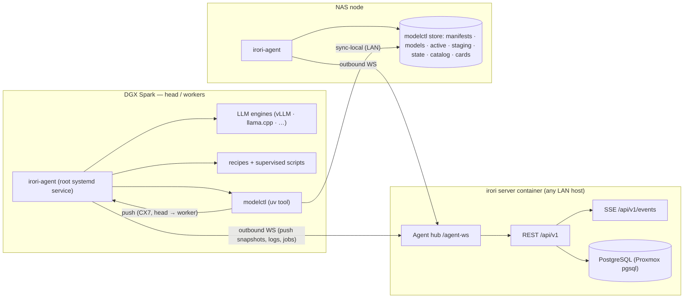

# Irori — Product & Technical Specification

Version: 0.1 · Status: **Draft (M0)** · Owner: piresbruno
Related: [PLAN.md](PLAN.md) · [adr/](adr/README.md) · [DEVELOPMENT_PROCESS.md](DEVELOPMENT_PROCESS.md)

A single-repository, Docker-first platform for **DGX Spark (GB10) homelabs**: one
server container (runs on any machine in the LAN — not necessarily a Spark), a
per-node **privileged agent**, and a NAS-backed model supply chain. Irori manages
Spark clusters focused on **inference**: live telemetry, model distribution
(NAS → head → workers over ConnectX-7), cluster serving from user-owned recipes,
benchmarks, and analytics.

Supersedes the four source projects it replaces: `sparkDash` (monitoring core),
`sparkControl` (command center, agent, serving), `modelctl` (model supply chain),
`sparkLimiter` (clock caps). Their feature set is narrowed, not ported 1:1.

---

## 1. Goals

1. **Manage DGX Sparks for inference** — the head node's serving state is the
   primary object of the UI: serving model, decode/prefill tok/s, queue
   running/waiting. Worker nodes report the essentials only: memory, CPU/GPU
   usage + temperature, total package power.
2. **One server, anywhere** — `docker compose up` on any LAN computer; no
   inbound ports on nodes; the agent connects out.
3. **NAS as the model source of truth** — search, download, delete models on the
   NAS; Sparks pull from the NAS, never from the internet when the model is
   already home. **Full compatibility with the `modelctl` store layout** — no NAS
   migration ever.
4. **One privileged agent per node** — root systemd service covering clocks,
   hardware info, model sync, inference monitoring, and serving supervision;
   no sudo prompts at runtime.
5. **Telemetry as a first-class citizen** — versioned snapshots, ring buffers,
   rollups, and an SSE stream are core architecture, not a feature bolt-on.
6. **BlasterSystems design system** — same visual language and app structure as
   `uptime-monitoring`: thread mark + product name + "A BlasterSystems product"
   endorsement.

### Non-goals (v1)

- **No auth / user management** — homelab trust model; the only secrets are SSH
  credentials and agent tokens, encrypted at rest.
- **No ancillary integrations** — ComfyUI, Hermes Agent, Tailscale probing,
  VulnHunter, REA, Glance are dropped.
- **No inference gateway / request tracing** in v1 (deferred — see §14).
- **No prompt showcase, alerts/notifications, Prometheus export, PWA** in v1.
- **No wall-meter power measurement** — estimates, clearly labeled.
- **No generated serve commands** — serving is user-owned recipes and scripts;
  `modelctl serve-command` output is surfaced for copy only.

---

## 2. Architecture overview

```
irori/                            (one repository — pnpm workspaces)
├── apps/
│   ├── server/        Express 5 + TS — REST /api/v1, SSE /api/v1/events,
│   │                  agent WS hub (/agent-ws), job runner, static SPA
│   ├── web/           Vue 3 + Vite SPA — BlasterSystems DS, served by server
│   └── agent/         Node agent — outbound WS to server; runs on Sparks + NAS
├── packages/
│   ├── core/          Shared contracts: snapshot shapes, config schemas, store layout
│   └── db/            Drizzle schema + migrations (PostgreSQL on the Proxmox pgsql server)
├── docker/            Dockerfile (server + agent roles), compose
└── docs/             SPEC, PLAN, ADRs, research briefs
```



- **One image, two roles** (same Dockerfile): `docker run irori server` /
  `irori agent`. The agent's primary install is **bare-metal**: an install
  script lays down the esbuild bundle + Node runtime + a **root systemd system
  unit** (`irori-agent.service`) — privileged by design so clock control, sysfs,
  and modelctl need no sudo gymnastics. Container agent is for testing.
- **Transports**: agent → server is an **outbound WebSocket** with token auth
  (survives NAT/tailnet; no inbound node ports); SSH is bootstrap + fallback
  only. Server → browser is **SSE**. Snapshot shapes are identical regardless of
  transport (`packages/core`).
- **modelctl stays the store engine** (Python, `uv tool`): the agent shells out
  to it (`list`, `path`, `download`, `queue`, `sync-local`, `push`, `delete`,
  `doctor`, `serve-command`) and streams output into jobs/telemetry. The store
  layout contract lives in `packages/core` so reads never require modelctl.

## 3. Nodes & fleet

- Node kinds: `spark` (head/worker/standalone roles), `gpu-host` (discrete NVIDIA
  GPU Linux box), `nas`. Registry is hot-editable (add/edit/remove, no restart).
- Node management UI (IRI-010): "Add node…" modal on the fleet page; the agent
  token is shown **exactly once** at create/rotate, alongside the agent env
  (`IRORI_SERVER_URL`, `IRORI_NODE_TOKEN`) and the `install-agent.sh` line.
  Edit / rotate / delete live on the node drill-down (delete is an armed
  two-click confirm). Rotation is **not** pushed live — `config-update`
  carries no token — so the env file is updated and `irori-agent` restarted;
  the old token fails at the agent's next hello.
- A **cluster** is a head plus its workers (recipe-declared via `NNODES` /
  `WORKER_IP`). UI grouping: cluster view is the default lens; per-node view is
  one click away.
- Node add: manual (host/IP + SSH credentials for bootstrap) → one-click agent
  install over SSH → agent takes over. mDNS/subnet auto-discovery is deferred.
- SSH credentials: AES-256-GCM at rest, never serialized to the API. Agent
  tokens: per-node, rotatable (connected agents get `config-update`).

## 4. Telemetry (first-class)

- **Collect** (in-agent): GPU via `nvidia-smi` (per-card usage, temp, power,
  VRAM, clocks, throttle reasons, processes), CPU (usage, temp, package power,
  per-core clock), memory, storage, network. GB10 unified-memory split and
  bandwidth on Sparks; RAM vs VRAM separation on discrete hosts.
- **Stream**: agent pushes snapshots on a server-configured cadence (default
  2 s) over the WS link; server keeps per-node ring buffers, broadcasts to SSE;
  browsers attach/detach without affecting collection. Poll loops run headless.
- **Store**: PostgreSQL (Proxmox pgsql server, `DATABASE_URL`) — raw snapshots
  ring (recent), minute buckets → hourly/daily rollups (Drizzle migrations),
  serving/bench/job event records. **Temperature minute buckets (min/avg/max
  per sensor) kept 7 d**, then hourly 90 d. Retention config, prune job.
  In-memory rings keep the live view while the DB is unreachable (ADR-0002).
- **Versioned contracts**: every snapshot carries `schemaVersion` +
  `agentVersion`; old agents and new servers negotiate via the hello handshake.

## 5. Inference monitoring

- Per-node LLM ports with backend auto-detection: vLLM, llama.cpp, SGLang, EXL3,
  TensorFold, q27, LM Studio, Ollama, ds4-server.
- Live: decode/prefill tok/s (engine counters where published), queue
  running/waiting, KV-cache usage, TTFT/E2E/ITL p95 (from engine `/metrics`
  when available), loaded model id. Workers run **detection-only** probes
  (10 s cadence) so the cluster view shows what actually runs where.
- Head card (primary surface): serving model, decode + prefill rates, queue
  run/total. Worker card (compact): memory, CPU/GPU usage + temp, package power.

## 6. Model supply chain (NAS + modelctl)

- The NAS node runs the same agent; its `nasRoot` points at the modelctl store.
  **Store layout is modelctl's, unchanged** (§2 diagram) — no migration.
- **Models page** reads `catalog.json` (schema 3) with live-scan fallback, and
  joins **HF metadata** (repo, revision, quantization, companions, cards) so
  users can find models and create recipes without leaving the app.
- Operations (all as supervised jobs with live output, one active per node):
  - **modelctl provisioning**: agent checks `uv` + `modelctl --version`
    against the pinned minimum and installs/upgrades from the pinned GitHub
    release (`uv tool install --force`); the release wheel ships inside the
    agent bundle as the offline fallback. Runs before any model op on a node.
  - **Search/download** on the NAS: HF id/URL → manifest generation → staged
    resumable download → validate → atomic publish → activate. GGUF
    quantization selection; mmproj/MTP companions detected. Queue YAML built
    server-side from form rows (raw YAML never accepted). Adding a download
    **always queues** (IRI-014, ADR-0009): the server inserts a pending
    `download_queue` row and drains all pending entries as one `download-queue`
    batch on the **NAS-preferred store node** (`pickStoreNode`: NAS kind first,
    fallback to a node with the store mounted) whenever it is idle; batch
    outcomes reconcile per entry, with retry reusing published objects.
  - **Delete**: dry-run plan → armed `--apply --yes`.
  - **sync-local** NAS → node HF cache (resumable rsync, ETag validation).
    Placement prefers a **push from an online local holder** when one exists —
    the CX7 fabric beats the SMB store hop (IR-100); sync-local is the
    fallback when no holder is reachable, and staged transfers apply the same
    preference (the store node's own sync stays — local disk copy).
    Transfers run as the node's **cache user** when one is set on the node
    (IR-101 / ADR-0011: `runuser`, the user's modelctl, scrubbed env), so
    models and registration state land in that user's HF cache instead of the
    agent's (root). Push destinations are dialed as `user@host` from the
    destination's cache user; prerequisites: modelctl installed for the cache
    user and passwordless user-level ssh between sparks. Unset = the agent
    user (root).
  - **push** node → node over the CX7 fabric (parallel rsync streams,
    `--host` per link, round-robin). Head pulls once, fans out to workers.
  - **doctor / repair / catalog refresh** surfaced with two-click armed apply.
- **Node drill-down inventory** (IRI-028): the node detail page lists what the
  node actually holds — the modelctl store (active models + failed-delete
  leftovers) when it has a `nasRoot`, and every local HF-cache registration per
  user (modelctl local state is per user; a root agent lists each cache owner
  through `runuser`). Rows carry size/repo/runtime and delete in place:
  `nas-delete-apply` for store models, `delete-local` for a local registration,
  `gc-objects` for a leftover. `nas-delete-apply` preflights every object and
  staging directory with a create+unlink probe after the read-only `--json`
  plan and **before** `--apply`, so a denied tree leaves the model active
  instead of orphaning its data (the NAS store can be a CIFS mount whose ACLs
  deny the agent's principal). The report is cached in `node_inventory` and
  invalidated by every model-mutating job settle.
- **Placement planning**: for model × node → `present / sync / push / unavailable`,
  offered as one-click remediations wherever a model is needed (serving
  start, setups). Capacity math shown (`free X GB · needs Y GB` minus
  reserve); a failed check offers **"Clean up disk — est. +N GB"** from the
  agent's disk audit (§11.6).
- **Catalog UX contract**: the Models page is one searchable table — search
  (name/repo/quantization), filters (runtime, placement), sort (**recently
  added** default — via Irori-side `first_seen_at`, since `catalog.json`
  carries no timestamp — plus name, size), pagination 25/page. Row click
  opens a **detail drawer** (HF metadata, files, companions, per-node
  placement + remediations, serve-command copy, armed delete). Downloads are
  added from a **modal** that takes a pasted list (one HF repo per line)
  parsed into editable rows — bulk submissions land as ONE `download_queue`
  batch (IRI-015) — with a persistent **queue panel** on the page (per-entry
  status/remove/retry; succeeded entries auto-clear ~60 s after the batch
  settles — stale ones on load — while failed/canceled stay until removed or
  retried, and the batch strip shows only while entries are pending or
  running, IRI-026); store hygiene (doctor/gc) a **popover** off the
  status strip. No inline form walls. Multi-quant GGUF repos are
  first-class (IRI-016): rows carry optional `quantization` (modelctl
  substring selection) and `mtp` (explicit draft companion), and an
  **Expand quants** flow lists a repo's quantizations from the hub
  (`GET /api/v1/hf-quants`, grouped like modelctl) and expands the row into
  one entry per selected quant (`{repo tail}-{TAG}` names); unselected
  quantizations are never downloaded.

## 7. Serving orchestration

- **Setup** = one serving configuration: model, nodes (single or cluster,
  ≤ 8 — most fleets are 1 head + 1 worker), and **one start/stop script pair
  on the head node** — the scripts orchestrate workers and define ports and
  engine config. Created through a **wizard**: type → model (NAS catalog
  search, or HF download chained) → per-node existence check → script paths
  **validated on the head** (`test -x` at create time, re-checked at every
  start) → placement plan → launch. Irori never edits the scripts.
- **Optional env**: Irori exports `MODEL_NAME`, `PORT`, `EXTRA_ARGS`, and
  `MODEL_PATH` (`modelctl path --local`) for scripts that want them — scripts
  may define their own ports/config and ignore it. A **stop script is
  required** — armed stop is a core promise (fallback: kill the recorded
  process group).
- **Health**: state = the node's LLM probe sees the engine (on its
  script-defined port) answering `/v1/models` with the model id;
  startup timeout surfaces "starting → healthy / failed" with the engine-log
  tail streamed into telemetry (ring buffer + persisted run log); detached
  drivers survive server restarts.
- **Placement in the wizard**: per-node present/sync/push/unavailable with
  capacity math (`free − needs − reserve`); missing models transfer in
  **staged progress** (HF→NAS download → NAS→head `sync-local` → head→worker
  `push` over CX7), each stage showing %, rate, ETA, cancel; busy-node
  warning; "pull from HF anyway" stays a ghost option; warnings never block.
- **UI scale**: setups render as **cards** (never an enterprise table),
  with a detail drawer: streamed engine log, per-node placement history,
  endpoints (direct), edit/duplicate/remove.

## 8. Benchmarks

Decode (multi-concurrency streaming tok/s; structured/prose/code/json tasks),
prefill (1k–300k context sweep, TTFT), quality (seeded GSM8K/MMLU-style suite,
temp 0, per-category scores, paired compare), tool-eval (agentic tool-use
trials). All run **via the agent** against live engines; results persisted with
history and comparison views. No VulnHunter/REA.

## 9. Analytics

One section, five lenses — **memory, decode, power, temps, tokens**
(generated / cache / prefill) — each groupable **by cluster and by individual
node**, with time ranges backed by rollups:

- Decode/prefill rates over time (per engine port, per node, per cluster).
- Tokens: generated / cached / prompt, minute + hourly + daily (ledger per
  model) — minute rows feed the Overview 30m/4h cost preview (IRI-025).
- Power: estimated watts (GPU board + CPU model + base overhead, clamped to
  the GB10 envelope), explicit coverage fields; monthly archive; Wh/token.
  Labeled *estimated, not wall-metered*. Constants (NVIDIA DGX Spark
  documentation): GB10 SOC TDP 140 W (GPU+CPU), 100 W budget for other
  components, 240 W peak system power — the estimator clamps
  gpu + cpu package + base overhead (default 40 W) to the 240 W system
  envelope before integrating.
- Memory: unified-memory pressure (GB10) / RAM+VRAM (discrete), trends.
- Temperatures: fleet strip (latest GPU/CPU per node, hottest first, no
  color-only tiers — ◇ warn ≥ 70 °C, ▫ critical ≥ 90 °C, shapes carry the
  tier), per-node GPU (solid) / CPU pkg (dashed) charts with 70/90 °C guide
  lines, **cluster view = fleet-max aggregates** (thermals don't add; 8-node
  per-node lines would be soup), and throttle/crossing **event markers**
  joined from the event log + `clocks_throttle_reasons` (no rules engine).
  Minute buckets (min/avg/**max** — max preserves spikes) kept 7 d; 7d views
  decimate via min/max pairs, never plain averages.

## 10. Clock control (CPU & GPU underclocking)

- GPU: `nvidia-smi -lgc MAX` / `-rgc`; locked when applications clock ≠ default.
- CPU: per-core `cpufreq` `scaling_max_freq` cap (kHz) — **not** `max_perf` on
  GB10 (accepted but re-derived); reset from `cpuinfo_max_freq`.
- Executed by the **privileged agent directly** (it runs as root — no helper
  install, no sudoers dance). Desired state (`gpu`, `cpu`) stored server-side;
  re-applied on every node online transition. Fleet-wide apply to all Sparks.

## 11. Agent (per node)

Single daemon, all node functionality. Outbound WS + token; SSH fallback for
bootstrap and when the agent is off.

1. **Underclock CPU/GPU** (§10).
2. **Hardware information** — static inventory (GB10/SoC, memory, NICs incl.
   CX7 links, storage) + live collectors (§4).
3. **Sync models from NAS** — `sync-local` orchestration (§6).
4. **Sync models between DGXs** — `push` orchestration incl. CX7 multi-link
   fan-out (§6).
5. **Monitor realtime inference** — LLM port probing, engine metrics, serving
   supervision with log streaming (§5, §7).
6. **Disk hygiene** — nodes accumulate heavy clutter (docker build cache and
   old engine images, HF `.incomplete` blobs and unreferenced snapshots,
   non-resumable modelctl staging, compiler caches in
   `~/.cache/{vllm,torch,triton}` + `~/.nv`, pip/uv/apt caches, journal,
   stale `/tmp`, core dumps). The agent provides:
   - **Audit** (read-only job): per-category reclaimable report with a
     one-line safety rationale each; cached ~5 min; surfaced in the Disk
     hygiene drawer — not on the node card (IR-98: the card's DISK row shows
     the device disk — the fs backing `/`, mounted volumes ignored — and the
     bar trails the available space in the warn hue instead of a usage chip).
   - **Clean** (armed, per category, streamed job output — never one opaque
     button): docker build-cache/dangling-image/stopped-container prunes,
     old-image policy (keep last 2 per repo, exclude in-use), HF incomplete/
     unreferenced-blob cleanup, modelctl `cleanup-staging` (non-resumable
     only), compiler/pkg cache wipes, journal vacuum, apt clean + autoremove,
     `/tmp` > 7d, core dumps, old snap revisions.
   - **Protected set (enforced)**: modelctl active objects and registered
     HF-cache entries (`modelctl list --local`), images of running
     containers, files open by engines (`/proc` check), anything modified
     < 24 h outside caches, the NAS store.
   - **Prevent (opt-in)**: one-time docker `daemon.json` log rotation
     (`max-size 10m, max-file 3`); weekly scheduled pass over the
     always-safe set only (build cache, compiler/pkg caches, tmp, journal).
   - **Placement tie-in**: a failed capacity check offers
     "Clean up disk — est. +N GB" linking to the audit.
   - **UI contract**: per-node **Cleanup drawer** (Audit | History tabs,
     models/serve drawer chrome). Audit = an 8-category checklist — checkbox ·
     name + safety rationale · scaled bar · item count · size — with
     **safe categories pre-checked and needs-care rows opt-in** (diamond
     `care` chip; docker old images, HF cache, modelctl staging), zero rows
     disabled. IRI-028: each category also lists its concrete targets
     (`details`: old images, HF incomplete blobs vs unreferenced snapshots,
     staging entries, compiler dirs, journal/tmp/core dirs) with per-target
     bytes. Flow: **audit → typed node-name confirm → staged streamed run**
     (no dry-run plan CTA; the audit is the plan; a failing category flips to
     held/failed and the rest continue). Threshold chips:
     `chip--warn` ≥ 80 % usage, none under 80 %; completion lands in
     the drawer result, History (last 20 · 90 d; output kept 30 d), the fleet
     event log, and re-derives the chips. Prevention lives per-node at the
     drawer bottom (weekly safe-set `.pick` + one-time log-rotation state
     chip). Safety copy uses `--muted`, never `--faint`.

   - **Activity** (IRI-028): a global topbar drawer lists every job across the
     fleet — active first, then recent — with the last output line, expandable
     output (the persisted 400-line ring) and cancel. The hub seeds it from
     `GET /api/v1/jobs` and follows SSE `job` frames (running on dispatch,
     terminal on settle) plus a throttled `job-progress` frame (≤1/s per job),
     so leaving the modal that started a download never loses its log. Job
     start/settle lines also land in the Overview Telemetry feed; progress
     stays out of the feed ring.

Bootstrap: server UI generates an install one-liner (or SSH-pushes the bundle
using stored credentials): bundle + config (server URL, token) + root systemd
unit. Install completes only when the WS hello lands. Token rotation pushes
`config-update`; disconnected agents are re-bootstrapped. Agent version is
reported in every snapshot; upgrade = re-run install.

7. **Usage capture** (M8, ADR-0008) — opt-in per setup
   (`captureProxy`): the agent binds the setup's declared LAN port and
   forwards to a loopback engine port injected as `$PORT` (the start script
   must honor it; the wizard pre-fills a loopback-bind hint in `EXTRA_ARGS`).
   The proxy is a raw byte pipe with a passive capped tee: streaming is
   byte-identical, capture failures degrade to pass-through, and only
   OpenAI-compat inference requests are recorded (probes/`/metrics` are
   forwarded uncaptured). Per request: model, endpoint, status, finish
   reason, errors (+ normalized signature), duration/TTFT/decode tok/s,
   prompt/completion/cached/reasoning/total tokens, the TensorFold block
   verbatim, payload sizes, source address — no bodies (IR-51). Captured
   events land in a node-local SQLite WAL buffer (expendable, 90 d / capped)
   and sync to Postgres in ≤500-event batches with ack-driven deletion and
   UUID dedup (exactly-once). Raw retention 90 d, hourly/daily buckets 1 y,
   keyed on server ingest time.

## 12. Security model (homelab)

- No application auth, no user management. The server binds LAN; document the
  trust boundary. Remote access = the user's own Tailscale/reverse proxy.
- Secrets: SSH credentials + agent tokens AES-256-GCM (`ENCRYPTION_KEY`), never
  in API responses or logs.
- Agent link: per-node token; outbound-only connection; the agent executes
  server-supplied jobs (argv or shell mode, output ring, per-node single-active
  job limit) — it is root, so the server↔agent channel is the security
  boundary; tokens are rotatable and nodes are revocable.

## 13. API surface (v1)

| Area | Endpoints |
|---|---|
| Nodes | `GET/POST /api/v1/nodes`, `PATCH/DELETE /api/v1/nodes/:id`, `PUT /api/v1/nodes/order`, `POST /api/v1/nodes/:id/agent-update`, `POST /api/v1/nodes/:id/token/rotate`, `GET /install-agent.sh`, `GET /irori-agent.service`, `GET /agent/irori-agent.mjs` |
| Telemetry | `GET /api/v1/nodes/:id/snapshot`, `/:id/history?range=`, `GET /api/v1/events` (SSE), `GET /api/v1/events/recent?limit=` (feed history, IRI-013) |
| Inference | `GET /api/v1/nodes/:id/llm`, `PUT /:id/llm-ports`, `GET /api/v1/clusters/:id` |
| Models | `GET /api/v1/models?q=&sort=&page=`, `GET/POST /api/v1/downloads` + `DELETE /api/v1/downloads/:id` + `POST /api/v1/downloads/:id/retry` (queue, IRI-014), `GET /api/v1/nodes/:id/models` + `POST /api/v1/nodes/:id/models/refresh` (per-node inventory, IRI-028), `POST /api/v1/nodes/:id/jobs` (`nas-delete-apply`, `delete-local`, `gc-objects`, `sync-local`, `push`), `GET /api/v1/placement?model=&node=` |
| Serving | `GET/POST /api/v1/setups`, `PATCH/DELETE /api/v1/setups/:id`, `POST /api/v1/setups/:id/start\|stop`, `GET /api/v1/setups/:id/log` (stream) |
| Jobs | `GET /api/v1/jobs?limit=` (recent, last output line), `GET /api/v1/jobs/:id`, `POST /api/v1/jobs/:id/cancel`; SSE `job` (running + terminal) and throttled `job-progress` frames |
| Cleanup | `GET /api/v1/nodes/:id/cleanup`, `PUT /api/v1/nodes/:id/hygiene`; agent-side `hygiene-audit` / `hygiene-clean` / `hygiene-prevent` jobs (the clean still accepts `dryRun`, the UI no longer plans first) |
| Benchmarks | `POST /api/v1/bench/{decode,prefill,quality,tooleval}`, `GET /api/v1/bench/:type/runs` |
| Usage | `GET /api/v1/usage/{overview,requests,errors,agents,tools,models}?range=`, `GET /api/v1/usage/requests/:id` (M8, ADR-0008), `GET /api/v1/usage/chats` + `GET /api/v1/usage/chats/:id` (IR-53, ADR-0010), `GET/POST /api/v1/usage/clients` + `DELETE /api/v1/usage/clients/:id` (IR-55) |
| Clocks | `GET /api/v1/nodes/:id/clocks`, `POST /api/v1/nodes/:id/clocks` |
| Meta | `GET /healthz`, `GET /api/v1/version`, `GET /api/v1/settings`, `PUT /api/v1/settings`, `GET/PUT /api/v1/settings/hf-token` (global HF token, ADR-0009), `GET/PUT /api/v1/settings/cadence-ms` (snapshot cadence, IR-87), `GET/PUT /api/v1/settings/energy-cost` + `/token-cost` (cost settings, IRI-025), WS `/agent-ws` |

## 14. Deviations & deferred

- **Shipped (M8):** usage **capture** only — the deferred "inference gateway"
  is rescoped per the IRI-009 research brief: an in-agent pass-through proxy
  records usage; no routing, fallbacks, or auth (no gateway features).
- **Shipped (usage phase 2, IR-51 epic / ADR-0010):** opt-in body retention
  (`Keep bodies` per flagged setup, content-addressed gzip parts, refcounted,
  16/4 MiB caps, parts die with their owning rows), chats reconstruction
  (`#/chats`: prefix-chained sessions, compaction markers, byte-exact images,
  tool blocks), tool attribution from the wire (per request sums exact,
  `unknown` fallback), client identity (issued keys fingerprinted sha256 at
  the proxy; `X-Irori-Project` / `X-Irori-Agent-Type` / `X-Irori-Client`
  headers; `X-Irori-Retry` lineage; source-IP fallback labels). Body bytes
  are served only by the chats endpoints; browsers receive metadata.
- **Deferred (not shipped):** gateway features proper (request routing,
  fallbacks), alert notifications, Prometheus export, PWA/mobile,
  health-findings rules engine, prompt showcase, auto-discovery of Sparks,
  recipe git-drift tracking (setups re-validate script existence at start
  instead).
  All are additive; the data model keeps event/history tables extensible.
- **Dropped:** ComfyUI/Hermes/Tailscale monitoring, VulnHunter, REA, Glance.
- **modelctl** remains a separate upstream project (Python); Irori requires it
  on model-ops nodes and pins a minimum version (install/upgrade job).
