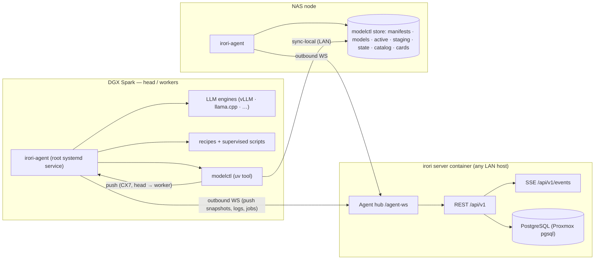

# Irori — Product & Technical Specification

Version: 0.1 · Status: **Draft (M0)** · Owner: piresbruno
Related: [PLAN.md](PLAN.md) · [adr/](adr/README.md) · [DEVELOPMENT_PROCESS.md](DEVELOPMENT_PROCESS.md)

A single-repository, Docker-first platform for **DGX Spark (GB10) homelabs**: one
server container (runs on any machine in the LAN — not necessarily a Spark), a
per-node **privileged agent**, and a NAS-backed model supply chain. Irori manages
Spark clusters focused on **inference**: live telemetry, model distribution
(NAS → head → workers over ConnectX-7), cluster serving from user-owned recipes,
benchmarks, and analytics.

Supersedes the four source projects it replaces: `sparkDash` (monitoring core),
`sparkControl` (command center, agent, serving), `modelctl` (model supply chain),
`sparkLimiter` (clock caps). Their feature set is narrowed, not ported 1:1.

---

## 1. Goals

1. **Manage DGX Sparks for inference** — the head node's serving state is the
   primary object of the UI: serving model, decode/prefill tok/s, queue
   running/waiting. Worker nodes report the essentials only: memory, CPU/GPU
   usage + temperature, total package power.
2. **One server, anywhere** — `docker compose up` on any LAN computer; no
   inbound ports on nodes; the agent connects out.
3. **NAS as the model source of truth** — search, download, delete models on the
   NAS; Sparks pull from the NAS, never from the internet when the model is
   already home. **Full compatibility with the `modelctl` store layout** — no NAS
   migration ever.
4. **One privileged agent per node** — root systemd service covering clocks,
   hardware info, model sync, inference monitoring, and serving supervision;
   no sudo prompts at runtime.
5. **Telemetry as a first-class citizen** — versioned snapshots, ring buffers,
   rollups, and an SSE stream are core architecture, not a feature bolt-on.
6. **BlasterSystems design system** — same visual language and app structure as
   `uptime-monitoring`: thread mark + product name + "A BlasterSystems product"
   endorsement.

### Non-goals (v1)

- **No auth / user management** — homelab trust model; the only secrets are SSH
  credentials and agent tokens, encrypted at rest.
- **No ancillary integrations** — ComfyUI, Hermes Agent, Tailscale probing,
  VulnHunter, REA, Glance are dropped.
- **No inference gateway / request tracing** in v1 (deferred — see §14).
- **No prompt showcase, alerts/notifications, Prometheus export, PWA** in v1.
- **No wall-meter power measurement** — estimates, clearly labeled.
- **No generated serve commands** — serving is user-owned recipes and scripts;
  `modelctl serve-command` output is surfaced for copy only.

---

## 2. Architecture overview

```
irori/                            (one repository — pnpm workspaces)
├── apps/
│   ├── server/        Express 5 + TS — REST /api/v1, SSE /api/v1/events,
│   │                  agent WS hub (/agent-ws), job runner, static SPA
│   ├── web/           Vue 3 + Vite SPA — BlasterSystems DS, served by server
│   └── agent/         Node agent — outbound WS to server; runs on Sparks + NAS
├── packages/
│   ├── core/          Shared contracts: snapshot shapes, config schemas, store layout
│   └── db/            Drizzle schema + migrations (PostgreSQL on the Proxmox pgsql server)
├── docker/            Dockerfile (server + agent roles), compose
└── docs/             SPEC, PLAN, ADRs, research briefs
```



- **One image, two roles** (same Dockerfile): `docker run irori server` /
  `irori agent`. The agent's primary install is **bare-metal**: an install
  script lays down the esbuild bundle + Node runtime + a **root systemd system
  unit** (`irori-agent.service`) — privileged by design so clock control, sysfs,
  and modelctl need no sudo gymnastics. Container agent is for testing.
- **Transports**: agent → server is an **outbound WebSocket** with token auth
  (survives NAT/tailnet; no inbound node ports); SSH is bootstrap + fallback
  only. Server → browser is **SSE**. Snapshot shapes are identical regardless of
  transport (`packages/core`).
- **modelctl stays the store engine** (Python, `uv tool`): the agent shells out
  to it (`list`, `path`, `download`, `queue`, `sync-local`, `push`, `delete`,
  `doctor`, `serve-command`) and streams output into jobs/telemetry. The store
  layout contract lives in `packages/core` so reads never require modelctl.

## 3. Nodes & fleet

- Node kinds: `spark` (head/worker/standalone roles), `gpu-host` (discrete NVIDIA
  GPU Linux box), `nas`. Registry is hot-editable (add/edit/remove, no restart).
- A **cluster** is a head plus its workers (recipe-declared via `NNODES` /
  `WORKER_IP`). UI grouping: cluster view is the default lens; per-node view is
  one click away.
- Node add: manual (host/IP + SSH credentials for bootstrap) → one-click agent
  install over SSH → agent takes over. mDNS/subnet auto-discovery is deferred.
- SSH credentials: AES-256-GCM at rest, never serialized to the API. Agent
  tokens: per-node, rotatable (connected agents get `config-update`).

## 4. Telemetry (first-class)

- **Collect** (in-agent): GPU via `nvidia-smi` (per-card usage, temp, power,
  VRAM, clocks, throttle reasons, processes), CPU (usage, temp, package power,
  per-core clock), memory, storage, network. GB10 unified-memory split and
  bandwidth on Sparks; RAM vs VRAM separation on discrete hosts.
- **Stream**: agent pushes snapshots on a server-configured cadence (default
  2 s) over the WS link; server keeps per-node ring buffers, broadcasts to SSE;
  browsers attach/detach without affecting collection. Poll loops run headless.
- **Store**: PostgreSQL (Proxmox pgsql server, `DATABASE_URL`) — raw snapshots
  ring (recent), minute buckets → hourly/daily rollups (Drizzle migrations),
  serving/bench/job event records. Retention config, prune job. In-memory
  rings keep the live view while the DB is unreachable (ADR-0002).
- **Versioned contracts**: every snapshot carries `schemaVersion` +
  `agentVersion`; old agents and new servers negotiate via the hello handshake.

## 5. Inference monitoring

- Per-node LLM ports with backend auto-detection: vLLM, llama.cpp, SGLang, EXL3,
  TensorFold, q27, LM Studio, Ollama, ds4-server.
- Live: decode/prefill tok/s (engine counters where published), queue
  running/waiting, KV-cache usage, TTFT/E2E/ITL p95 (from engine `/metrics`
  when available), loaded model id. Workers run **detection-only** probes
  (10 s cadence) so the cluster view shows what actually runs where.
- Head card (primary surface): serving model, decode + prefill rates, queue
  run/total. Worker card (compact): memory, CPU/GPU usage + temp, package power.

## 6. Model supply chain (NAS + modelctl)

- The NAS node runs the same agent; its `nasRoot` points at the modelctl store.
  **Store layout is modelctl's, unchanged** (§2 diagram) — no migration.
- **Models page** reads `catalog.json` (schema 3) with live-scan fallback, and
  joins **HF metadata** (repo, revision, quantization, companions, cards) so
  users can find models and create recipes without leaving the app.
- Operations (all as supervised jobs with live output, one active per node):
  - **modelctl provisioning**: agent checks `uv` + `modelctl --version`
    against the pinned minimum and installs/upgrades from the pinned GitHub
    release (`uv tool install --force`); the release wheel ships inside the
    agent bundle as the offline fallback. Runs before any model op on a node.
  - **Search/download** on the NAS: HF id/URL → manifest generation → staged
    resumable download → validate → atomic publish → activate. GGUF
    quantization selection; mmproj/MTP companions detected. Queue YAML built
    server-side from form rows (raw YAML never accepted).
  - **Delete**: dry-run plan → armed `--apply --yes`.
  - **sync-local** NAS → node HF cache (resumable rsync, ETag validation).
  - **push** node → node over the CX7 fabric (parallel rsync streams,
    `--host` per link, round-robin). Head pulls once, fans out to workers.
  - **doctor / repair / catalog refresh** surfaced with two-click armed apply.
- **Placement planning**: for model × node → `present / sync / push / unavailable`,
  offered as one-click remediations wherever a model is needed (serving start,
  recipes). Capacity math shown (`free X GB · needs Y GB` minus reserve).
- **Catalog UX contract**: the Models page is one searchable table — search
  (name/repo/quantization), filters (runtime, placement), sort (**recently
  added** default — via Irori-side `first_seen_at`, since `catalog.json`
  carries no timestamp — plus name, size), pagination 25/page. Row click
  opens a **detail drawer** (HF metadata, files, companions, per-node
  placement + remediations, serve-command copy, armed delete). The download
  queue is a **modal**; store hygiene (doctor/gc) a **popover** off the
  status strip. No inline form walls.

## 7. Serving orchestration

- **Setup** = one serving configuration: model, nodes (single or cluster,
  ≤ 8 — most fleets are 1 head + 1 worker), start/stop script paths per
  role, and a port. Created through a **wizard**: type → model (NAS catalog
  search, or HF download chained) → per-node existence check → script paths
  **validated on each target node** (`test -x` at create time, re-checked at
  every start) → placement plan → launch. Irori never edits the scripts.
- **Env contract**: Irori exports `MODEL_NAME`, `PORT`, `EXTRA_ARGS`, and
  `MODEL_PATH` (`modelctl path --local`) to the scripts; self-contained
  scripts ignore them. A **stop script is required** — armed stop is a core
  promise (fallback: kill the recorded process group).
- **Health**: state = the port answers `/v1/models` with the model id;
  startup timeout surfaces "starting → healthy / failed" with the engine-log
  tail streamed into telemetry (ring buffer + persisted run log); detached
  drivers survive server restarts.
- **Placement in the wizard**: per-node present/sync/push/unavailable with
  capacity math (`free − needs − reserve`); missing models transfer in
  **staged progress** (HF→NAS download → NAS→head `sync-local` → head→worker
  `push` over CX7), each stage showing %, rate, ETA, cancel; busy-node
  warning; "pull from HF anyway" stays a ghost option; warnings never block.
- **UI scale**: setups render as **cards** (never an enterprise table),
  with a detail drawer: streamed engine log, per-node placement history,
  endpoints (direct), edit/duplicate/remove.

## 8. Benchmarks

Decode (multi-concurrency streaming tok/s; structured/prose/code/json tasks),
prefill (1k–300k context sweep, TTFT), quality (seeded GSM8K/MMLU-style suite,
temp 0, per-category scores, paired compare), tool-eval (agentic tool-use
trials). All run **via the agent** against live engines; results persisted with
history and comparison views. No VulnHunter/REA.

## 9. Analytics

One section, four lenses — **memory, decode, power, tokens** (generated /
cache / prefill) — each groupable **by cluster and by individual node**,
with time ranges backed by rollups:

- Decode/prefill rates over time (per engine port, per node, per cluster).
- Tokens: generated / cached / prefill, hourly + daily (ledger per model).
- Power: estimated watts (GPU board + CPU model + base overhead, clamped to
  the GB10 envelope), explicit coverage fields; monthly archive; Wh/token.
  Labeled *estimated, not wall-metered*.
- Memory: unified-memory pressure (GB10) / RAM+VRAM (discrete), trends.

## 10. Clock control (CPU & GPU underclocking)

- GPU: `nvidia-smi -lgc MAX` / `-rgc`; locked when applications clock ≠ default.
- CPU: per-core `cpufreq` `scaling_max_freq` cap (kHz) — **not** `max_perf` on
  GB10 (accepted but re-derived); reset from `cpuinfo_max_freq`.
- Executed by the **privileged agent directly** (it runs as root — no helper
  install, no sudoers dance). Desired state (`gpu`, `cpu`) stored server-side;
  re-applied on every node online transition. Fleet-wide apply to all Sparks.

## 11. Agent (per node)

Single daemon, all node functionality. Outbound WS + token; SSH fallback for
bootstrap and when the agent is off.

1. **Underclock CPU/GPU** (§10).
2. **Hardware information** — static inventory (GB10/SoC, memory, NICs incl.
   CX7 links, storage) + live collectors (§4).
3. **Sync models from NAS** — `sync-local` orchestration (§6).
4. **Sync models between DGXs** — `push` orchestration incl. CX7 multi-link
   fan-out (§6).
5. **Monitor realtime inference** — LLM port probing, engine metrics, serving
   supervision with log streaming (§5, §7).

Bootstrap: server UI generates an install one-liner (or SSH-pushes the bundle
using stored credentials): bundle + config (server URL, token) + root systemd
unit. Install completes only when the WS hello lands. Token rotation pushes
`config-update`; disconnected agents are re-bootstrapped. Agent version is
reported in every snapshot; upgrade = re-run install.

## 12. Security model (homelab)

- No application auth, no user management. The server binds LAN; document the
  trust boundary. Remote access = the user's own Tailscale/reverse proxy.
- Secrets: SSH credentials + agent tokens AES-256-GCM (`ENCRYPTION_KEY`), never
  in API responses or logs.
- Agent link: per-node token; outbound-only connection; the agent executes
  server-supplied jobs (argv or shell mode, output ring, per-node single-active
  job limit) — it is root, so the server↔agent channel is the security
  boundary; tokens are rotatable and nodes are revocable.

## 13. API surface (v1)

| Area | Endpoints |
|---|---|
| Nodes | `GET/POST /api/v1/nodes`, `PATCH/DELETE /api/v1/nodes/:id`, `PUT /api/v1/nodes/order`, `POST /api/v1/nodes/:id/test`, `/:id/install-agent`, `/:id/agent-token/rotate` |
| Telemetry | `GET /api/v1/nodes/:id/snapshot`, `/:id/history?range=`, `GET /api/v1/events` (SSE) |
| Inference | `GET /api/v1/nodes/:id/llm`, `PUT /:id/llm-ports`, `GET /api/v1/clusters/:id` |
| Models | `GET /api/v1/models?scope=nas\|node:id&q=&sort=&page=`, `POST /api/v1/models/download`, `POST /api/v1/models/:name/delete`, `POST /api/v1/nodes/:id/sync`, `POST /api/v1/nodes/:id/push`, `GET /api/v1/placement?model=&node=` |
| Serving | `GET/POST /api/v1/setups`, `PATCH/DELETE /api/v1/setups/:id`, `POST /api/v1/setups/:id/start\|stop`, `GET /api/v1/setups/:id/log` (stream) |
| Jobs | `GET /api/v1/jobs/:id`, `POST /api/v1/jobs/:id/cancel` |
| Benchmarks | `POST /api/v1/bench/{decode,prefill,quality,tooleval}`, `GET /api/v1/bench/:type/runs` |
| Clocks | `GET /api/v1/nodes/:id/clocks`, `POST /api/v1/nodes/:id/clocks` |
| Meta | `GET /healthz`, `GET /api/v1/settings`, `PUT /api/v1/settings`, WS `/agent-ws` |

## 14. Deviations & deferred

- **Deferred (not in v1):** inference gateway + request analysis (sparkControl's
  proxy/trace store), alert notifications, Prometheus export, PWA/mobile,
  health-findings rules engine, prompt showcase, auto-discovery of Sparks,
  recipe git-drift tracking (setups re-validate script existence at start
  instead).
  All are additive; the data model keeps event/history tables extensible.
- **Dropped:** ComfyUI/Hermes/Tailscale monitoring, VulnHunter, REA, Glance.
- **modelctl** remains a separate upstream project (Python); Irori requires it
  on model-ops nodes and pins a minimum version (install/upgrade job).
